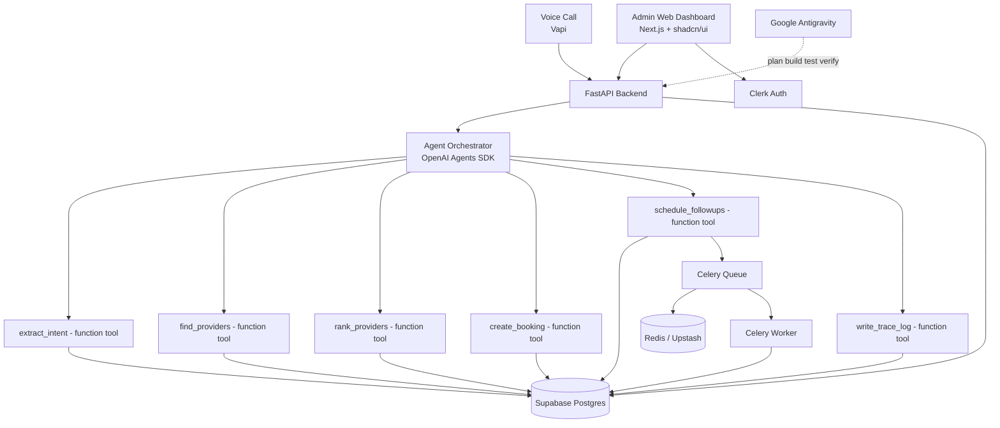
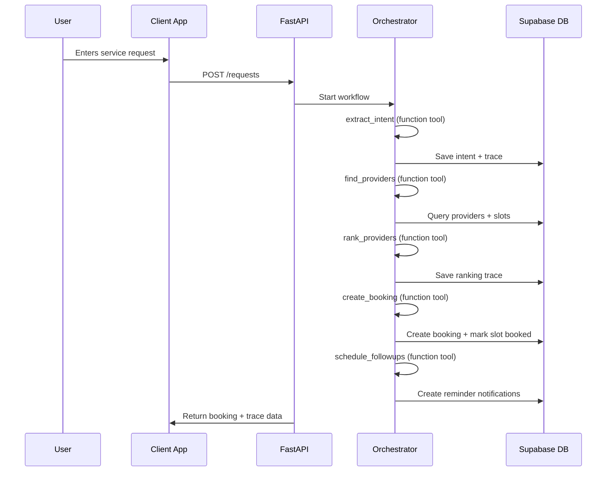
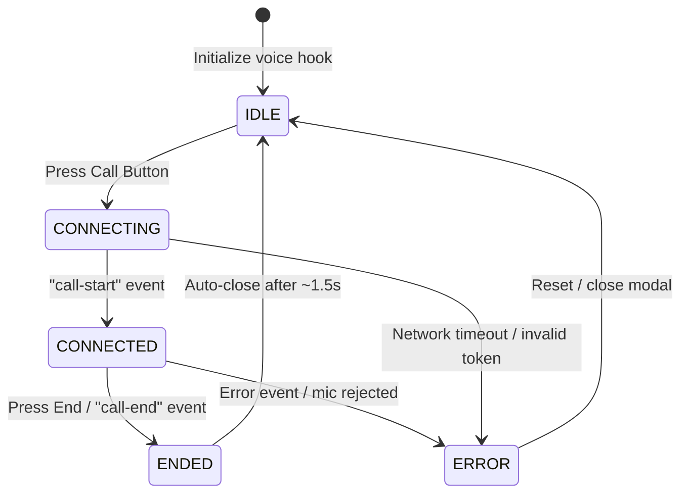
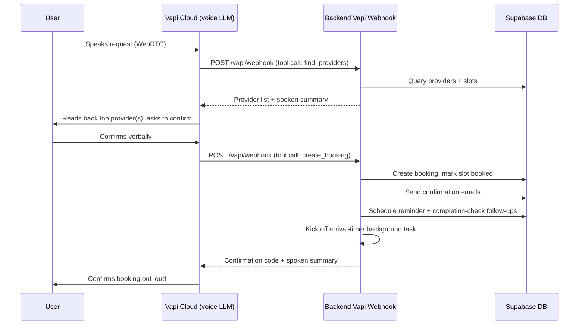
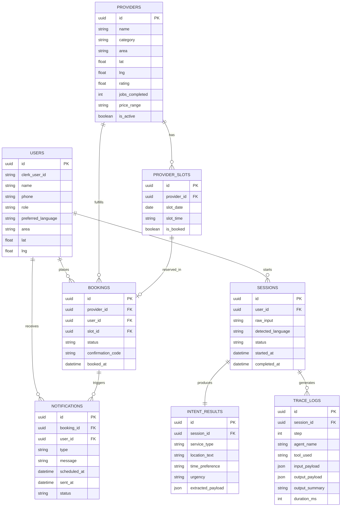

# AI Service Marketplace — Product Requirements Document (PRD)

## 1. Summary

A multi-agent AI service marketplace that helps users book local services — AC technicians, plumbers, electricians, tutors, and cleaners.

Users enter requests in **English, Urdu, or Roman Urdu**. The system extracts intent, finds matching providers, ranks them, simulates a booking, schedules follow-ups, and stores full trace logs for transparency.

> **Update:** For the MVP, agents call Python function tools **directly** via the OpenAI Agents SDK's native function-calling. This keeps the system simple to build and debug for the hackathon timeline.
>
> **Repo status note:** the live `invoista-antigravity-hackthon` repo has already gone further than this simplified plan — it runs a real 5-sub-agent orchestrator with a human-in-the-loop approval gate before booking and a Gemini fallback model, **plus** a separate real-time voice agent built on Vapi (see §10). This PRD's simplified function-tool version is the target baseline being discussed for the MVP, not a description of what's currently deployed.

---

## 2. Goals & Priorities

**Sprint goal:** Build a balanced hackathon MVP with:
- Strong agent backend
- Native function-tool architecture (OpenAI Agents SDK)
- Clean trace logs
- Working booking simulation
- Polished admin dashboard UI (Next.js + shadcn/ui)
- Stable demo flow

**Priority order:**

```
Agent trace visibility > booking logic > UI polish > optional extras
```

**Non-goals for MVP:** Do not overbuild maps, payments, chat, or real provider integrations.

---

## 3. Core Flow

```
User request
  → Intent extraction
  → Provider discovery
  → Provider ranking
  → Booking simulation
  → Follow-up scheduling
  → Trace log visibility
```

---

## 4. Tech Stack

| Layer             | Technology                              |
| ----------------- | ---------------------------------------- |
| Admin Web Dashboard | Next.js + shadcn/ui (Tailwind + Radix) |
| Backend API       | FastAPI                                 |
| Agent Runtime     | OpenAI Agents SDK                       |
| Tool Layer        | **Native function tools** (OpenAI Agents SDK `@function_tool`) |
| LLM Connectivity  | `AsyncOpenAI` + `OpenAIChatCompletionsModel` (Gemini fallback) |
| Database          | Supabase Postgres                       |
| DB Migrations     | **Alembic** (migrating schema onto Supabase Postgres) |
| Auth              | Clerk                                   |
| Queue             | Celery + Redis                          |
| Local Redis       | Docker Redis                            |
| Production Redis  | Upstash Redis                           |
| Deployment        | Google Cloud Run                        |
| Dev Workspace     | Google Antigravity                      |
| Voice Agent       | Vapi (WebRTC voice calling)             |

---

## 5. High-Level Architecture



Note: the agent tools are called **in-process** by the orchestrator as standard OpenAI Agents SDK function tools — no separate tool-server hop. The customer-facing request flow (typed or voice) is intentionally kept framework-agnostic here — see §16 open questions on what that client runs on.

---

## 6. Agent Flow



### 6.1 LLM Model Connectivity (Gemini Fallback)

The orchestrator and every sub-agent get their model from a small shared factory instead of hardcoding a provider. It's built from two classes:

- **`AsyncOpenAI`** (the `openai` SDK's async client) — instantiated once per provider, pointed at that provider's API key and `base_url`.
- **`OpenAIChatCompletionsModel`** (from the OpenAI Agents SDK) — wraps that client and exposes it as a `model=` any `Agent(...)` can use.

Because Gemini exposes an OpenAI-compatible chat endpoint, swapping providers is just a different `base_url`/API key pair passed into the same two classes — primary is `gpt-4o-mini` via OpenAI, falling back to `gemini-2.5-flash` via Google's OpenAI-compatible endpoint if the primary call fails.

---

## 7. Agent Function Tools

| Function Tool         | Purpose                                                  |
| ---------------------- | -------------------------------------------------------- |
| `extract_intent`       | Extract service type, location, time, urgency, language  |
| `find_providers`       | Find matching providers and available slots               |
| `rank_providers`       | Rank providers by rating, distance, and availability       |
| `create_booking`       | Create booking and confirmation code                       |
| `schedule_followups`   | Schedule reminder and completion check                    |
| `write_trace_log`      | Save agent reasoning and tool outputs                      |

Each is a plain Python function registered with the OpenAI Agents SDK via `@function_tool` — no external server process required.

---

## 8. Backend API Routes

| Method  | Route                                 | Purpose                    |
| ------- | -------------------------------------- | --------------------------- |
| GET     | `/health`                              | Health check                |
| POST    | `/requests`                            | Start full agent workflow   |
| GET     | `/requests/{session_id}`               | Get request/session result  |
| GET     | `/requests/{session_id}/trace`         | Get agent trace logs        |
| GET     | `/requests/{session_id}/trace/export`  | Export trace JSON           |
| GET     | `/providers`                           | List providers              |
| GET     | `/providers/{id}`                      | Provider details            |
| POST    | `/bookings`                            | Create manual booking       |
| GET     | `/bookings/{id}`                       | Booking receipt/status      |
| POST    | `/bookings/{id}/cancel`                | Cancel booking               |
| POST    | `/followups/trigger`                   | Demo trigger reminder        |
| GET     | `/me`                                  | Current user profile         |
| GET     | `/admin/traces`                        | Admin trace dashboard        |
| GET     | `/admin/sessions`                      | Admin sessions list          |
| GET     | `/admin/bookings`                      | Admin bookings list          |
| GET     | `/admin/providers`                     | Admin providers list         |
| POST    | `/admin/providers`                     | Add provider                 |
| PATCH   | `/admin/providers/{id}`                | Update provider              |

---

## 9. Multi-Role Web Architecture & Role-Specific Dashboards (Next.js 14 + shadcn/ui)

The web application provides a role-gated architecture partitioned into three distinct user personas: **Admin**, **Service Provider (Master Artisan)**, and **Customer (Homeowner/Client)**. Each persona is presented with an authenticated, tailored command console styled in the Midnight Emerald Obsidian (`#090E0C`) design aesthetic.

```mermaid
graph TD
    AuthGate["🔐 Auth Gatekeeper (/login, /signup)"] --> RoleCheck{"User Persona"}
    RoleCheck -->|Role: admin| AdminPortal["👑 Super Admin Operations Console"]
    RoleCheck -->|Role: provider| ProviderPortal["🛠️ Master Artisan Command Center"]
    RoleCheck -->|Role: customer| CustomerPortal["👤 Customer Concierge Hub"]

    subgraph "Admin Domain"
      AdminPortal --> AdminHUD["Global Telemetry & Latency HUD"]
      AdminPortal --> AdminLeaderboards["High-Active Customer & Provider Leaderboards"]
      AdminPortal --> AdminCustCRUD["Customer CRUD & Account Status"]
      AdminPortal --> AdminProvCRUD["Provider Roster CRUD & NADRA Vetting"]
      AdminPortal --> AdminTraces["5-Agent Diagnostic Traces & Observability"]
      AdminPortal --> AdminSettings["Platform Settings & Metro Controls"]
    end

    subgraph "Provider Domain"
      ProviderPortal --> ProvHUD["Earnings, Jobs & Dispatch Readiness"]
      ProviderPortal --> ProvBookings["Assigned Customers & Booking Management"]
      ProviderPortal --> ProvServices["Services CRUD & Live Customer Preview Card"]
      ProviderPortal --> ProvSlots["Calendar Slots & Availability Locks"]
    end

    subgraph "Customer Domain"
      CustomerPortal --> CustConcierge["Live AI Chat & WebRTC Voice Concierge"]
      CustomerPortal --> CustDirectory["Browse Verified Master Artisans Roster"]
      CustomerPortal --> CustBookings["My Bookings Ledger & Token Verification"]
      CustomerPortal --> CustProfile["Saved Addresses (ISB, KHI, LHE) & Profile"]
    end
```



---

### 9.1 Authentication & Gatekeeper Architecture

- **Login Requirement:** Unauthenticated visitors to any `/dashboard/*`, `/services`, `/traces`, `/bookings`, or `/providers` route are intercepted and redirected to `/login`. The public marketing landing page (`/`) remains accessible.
- **Role-Based Signup (`/signup`):**
  - **👑 System Administrator:** Operations oversight, agent trace telemetry, and marketplace governance.
  - **🛠️ Master Artisan / Provider:** Field technicians and specialists managing incoming bookings and service offerings.
  - **👤 Customer / Homeowner:** Clients booking vetted artisans via natural language Roman Urdu, Urdu, or English.
- **Demo Quick-Switcher Bar:** A top-level testing console allowing one-click role switching (`Admin` $\leftrightarrow$ `Provider (Tariq Mehmood)` $\leftrightarrow$ `Customer (Zubair Khan)`) for seamless evaluation without manual session re-entry.

---

### 9.2 Role 1: Super Admin Portal (`/dashboard/admin`)

The Admin console acts as the marketplace command deck and observability headquarters:

1. **Global Telemetry HUD:**
   - Real-time marketplace KPIs: Total Sessions, Confirmed Bookings, Gross Merchandise Value (GMV in PKR), Active Providers, and Median Agent Pipeline Latency (< 980ms).
2. **High-Active Leaderboards (User Requested):**
   - **Top Customers Leaderboard:** Ranked by total booking frequency, total lifetime spend (PKR), active service requests, and customer loyalty tier (Titanium, Platinum, Gold).
   - **Top Providers Leaderboard:** Ranked by customer satisfaction rating (★), total completed jobs, on-time arrival rate, and net earnings.
3. **Customer Management (Full CRUD):**
   - Paginated customer list with full search (name, phone, metro/city).
   - Create new customer records, update contact info and default address, view complete booking history, and toggle account status (Active / Suspended).
4. **Provider Roster Management (Full CRUD):**
   - Artisan management across all 5 trades (AC Technician, Plumber, Electrician, Detailing, STEM Tutor).
   - Add new artisans, verify NADRA biometric credentials, adjust pricing tiers, update specialties, and toggle active dispatch state.
5. **AI Agent Observability & Diagnostic Traces:**
   - 5-Agent Pipeline execution history (`/traces`): Step-by-step telemetry for Intent Extraction, Geospatial Discovery, Tri-Factor Ranking, Atomic Slot Locking, and Followup Dispatch.
   - Deep tool I/O JSON inspector and latency profiling per agent.
6. **Platform Governance & Settings:**
   - Platform commission configuration (e.g. 10%), active coverage clusters (Islamabad, Karachi, Lahore), and Vapi Voice RTC webhook diagnostics.

---

### 9.3 Role 2: Master Artisan / Provider Portal (`/dashboard/provider`)

Dedicated operational workstation for vetted service professionals:

1. **Artisan Command HUD:**
   - Today's upcoming appointments, monthly revenue tracker (PKR), verified rating score (★), and an immediate dispatch availability toggle: *"Online (Ready for Immediate Dispatch)"* vs *"In Field (Busy)"*.
2. **Assigned Customers & Booking Management (User Requested):**
   - Live queue of bookings assigned by the autonomous orchestrator.
   - Comprehensive customer profile card: Customer Name, Exact Address/Sector, Phone number, Reported Issue, and Booking Verification Code (`BK-XXXX`).
   - Job Lifecycle Action Controls:
     - `Mark En Route` (Notifies customer and updates ETA)
     - `Arrived at Location` (Prompts customer for entry verification)
     - `Complete Job & Verify Token` (Locks OTP token, closes booking, triggers escrow payout)
     - `Reschedule Request`
3. **Services Catalog CRUD & Live Customer Preview (User Requested):**
   - **Services CRUD:** Artisan can add, edit, or archive specialized services offered (e.g., *"Inverter AC Compressor Repair"*, *"Acoustic Leak Detection"*, *"3-Phase Solar Inverter Tuning"*), setting base rate (PKR), estimated job duration (mins), and warranty period.
   - **Live Client Preview Card:** Real-time visual mockup component showing the artisan exactly how their profile card, verified badges, rating, and service catalog appear to searching customers on the marketplace.
4. **Calendar Slots & Availability Manager:**
   - Interactive schedule grid to open or lock standard appointment slots (09:00 AM, 11:00 AM, 02:00 PM, 04:00 PM, 06:00 PM) across their operating metro cluster.

---

### 9.4 Role 3: Customer / Homeowner Concierge (`/dashboard/customer`)

Frictionless concierge portal for discovering and managing home services:

1. **Concierge Hub & Quick Booking:**
   - Active booking live status card with visual progress timeline (e.g. *"Tariq Mehmood is en route to Sector G-13 — ETA 15 mins"*).
   - 1-Click Re-book widget for frequently used artisans.
   - Integrated Roman Urdu / English text dispatch sandbox and acoustic Vapi WebRTC voice concierge.
2. **Browse Verified Artisans Directory (User Requested):**
   - Searchable, filterable roster of all master artisans categorized by trade and metro (Islamabad, Karachi, Lahore).
   - Rich artisan cards displaying NADRA vetting badge, average rating, distance estimation, pricing, verified customer reviews, and a direct *"Book Artisan"* button.
3. **My Bookings Ledger:**
   - Historical and active bookings table with confirmation tokens, artisan contact number, scheduled date/time, and post-service review & star rating submission.
4. **Saved Addresses & Preferences:**
   - Multi-address manager (e.g., *"Home — G-11/3 Islamabad"*, *"Office — Clifton Karachi"*) allowing AI agents to automatically match the customer's preferred geo-cluster without repeated prompting.

---

## 10. Voice Agent (Vapi Integration)

Alongside the typed chat flow, users can complete the entire booking by **speaking** to an AI concierge in a real-time voice call. This is a deliberately separate, lighter execution path from the text-chat orchestrator — optimized for low-latency conversation rather than multi-agent depth.

> Note: in the live repo this call currently launches from the mobile app's floating call button via `@vapi-ai/react-native`. Since this PRD no longer scaffolds a customer mobile client (§16), that entry point is a repo detail to revisit alongside the customer-app decision — everything from the webhook onward (§10.1 step 3 onward) is client-agnostic.

### 10.1 How it works end-to-end

1. User taps a floating call button on the mobile home screen.
2. The `@vapi-ai/react-native` SDK opens a WebRTC call directly to Vapi's hosted voice assistant (defined by a system prompt, not by our backend agents).
3. Vapi's own LLM carries the conversation, and calls exactly **two custom tools** over an HTTP webhook when it needs data or needs to act:
   - `find_providers`
   - `create_booking`
4. Our backend's Vapi webhook resolves the session/user, runs the requested action, and returns a structured result + a short spoken-friendly summary for Vapi's LLM to read back to the user.

### 10.2 Call state machine (client-side)



### 10.3 Voice vs. Chat — why the flow is intentionally different

| | **Chat** (typed requests) | **Voice** (Vapi call) |
| --- | --- | --- |
| Who drives the conversation | Orchestrator LLM (OpenAI Agents SDK) | Vapi's own assistant LLM |
| Tools available | 5 sub-agents, each with its own tool: discovery, ranking, booking, follow-up, notification | 2 direct tools via webhook: `find_providers`, `create_booking` |
| Provider ranking | Dedicated Ranking Agent scores providers | Skipped — the Vapi LLM just reads out the top 1–2 names/ratings itself |
| Booking confirmation gate | SDK human-in-the-loop interrupt (`needs_approval=True`) before booking | The spoken "Would you like me to book that for you?" *is* the confirmation gate — no separate approval step needed |
| Notifications / follow-ups / arrival timer | Run via their own agents/tools | Run the same way, just triggered directly by the webhook right after `create_booking` succeeds |

### 10.4 Voice webhook sequence



### 10.5 Session & user identity on a voice call

Since a voice call has no typed login form in front of it, the webhook resolves identity itself, in order:
1. Clerk JWT from the `Authorization` header, or from Vapi's call variables → decoded for the Clerk user ID.
2. A raw `user_id` passed in Vapi's call variables.
3. If the Clerk ID isn't in the database yet, a user row is **just-in-time provisioned** so the call can proceed.
4. As a last resort, falls back to the first user in the table (dev/demo safety net).

A session row is created idempotently before any tool runs, so trace logs always have somewhere to attach to.

### 10.6 UI

A glassmorphic, dark-themed call modal shows call status (`Connecting…`, `Listening…`, `Speaking…`, `Call Ended`) with an animated voice-wave visualizer, mute and end-call controls.

---

## 11. Data Model



---

## 12. Ranking Formula

```
score =
  rating_score      * 0.40
+ proximity_score    * 0.35
+ availability_score * 0.25
```

---

## 13. Main Demo Scenario

**User input:** "Mujhe kal subah G-13 mein AC technician chahiye"

**Expected result:**
- Intent Agent extracts AC Technician, G-13, tomorrow morning
- Discovery Agent finds nearby AC technicians
- Ranking Agent selects best provider
- Booking Agent creates simulated booking
- Follow-up Agent schedules reminder
- Admin can inspect trace logs

---

## 14. Recommended Folder Structure

```
backend/
  alembic/
    versions/
  alembic.ini
  app/
    main.py
    core/
      config.py
      security.py
      celery_app.py
    db/
      session.py
      models.py
      schemas.py
    agents/
      orchestrator.py
      intent_agent.py
      discovery_agent.py
      ranking_agent.py
      booking_agent.py
      followup_agent.py
      prompts.py
      outputs.py
      tools/
        intent_tools.py
        provider_tools.py
        ranking_tools.py
        booking_tools.py
        notification_tools.py
        trace_tools.py
    api/
      routes/
        requests.py
        providers.py
        bookings.py
        traces.py
        admin.py
        me.py
    workers/
      tasks.py

admin-web/
  app/
    layout.tsx
    page.tsx              # /dashboard — stats overview
    traces/
      page.tsx            # sessions table
      [sessionId]/
        page.tsx          # trace detail: agent timeline + tool I/O JSON
    bookings/
      page.tsx
    providers/
      page.tsx            # list + add/edit
  components/
    ui/
      [shadcn/ui generated primitives: button, card, table, dialog, badge, etc.]
    stats-cards.tsx
    sessions-table.tsx
    trace-timeline.tsx
    tool-io-viewer.tsx
    providers-table.tsx
  lib/
    api.ts                # calls the same FastAPI /admin/* routes
    utils.ts              # shadcn's cn() helper, etc.
  app/globals.css          # Tailwind base styles
  components.json          # shadcn/ui config
  tailwind.config.ts
```

**Notes on the folder structure:**
- `backend/` holds the agent orchestrator, its function tools, and the API — no separate mobile/frontend tree in this PRD for now (§16).
- `admin-web/` is a standalone Next.js App Router project — Tailwind + shadcn/ui live entirely here, generated into `components/ui/`. It talks to the same backend `/admin/*` routes as any other client.

---

## 15. Antigravity Agent Instructions

Use this project context to:
1. Generate backend FastAPI structure
2. Generate agent orchestrator + native function tools
3. Run Alembic migrations against Supabase Postgres for schema + seed data
4. Generate the Next.js + shadcn/ui admin dashboard screens
5. Wire admin dashboard routes to backend APIs
6. Add trace logging everywhere
7. Keep UI simple, clean, and demo-friendly

---

## 16. Open Questions

- ~~Keep Alembic as the migration tool for Supabase Postgres?~~ **Resolved:** yes — Alembic manages schema migrations against Supabase Postgres.
- ~~Where does shadcn/ui fit?~~ **Resolved:** it powers the standalone Next.js Admin Web Dashboard (§9), not a mobile app.
- Confirm: what does the customer-facing app run on? This PRD no longer scaffolds a React Native/Expo (or any other) client — for now the only customer entry point described is the Vapi voice call (§10).
- Confirm: what auth guards the Admin Web Dashboard — Clerk, or something simpler for a hackathon?